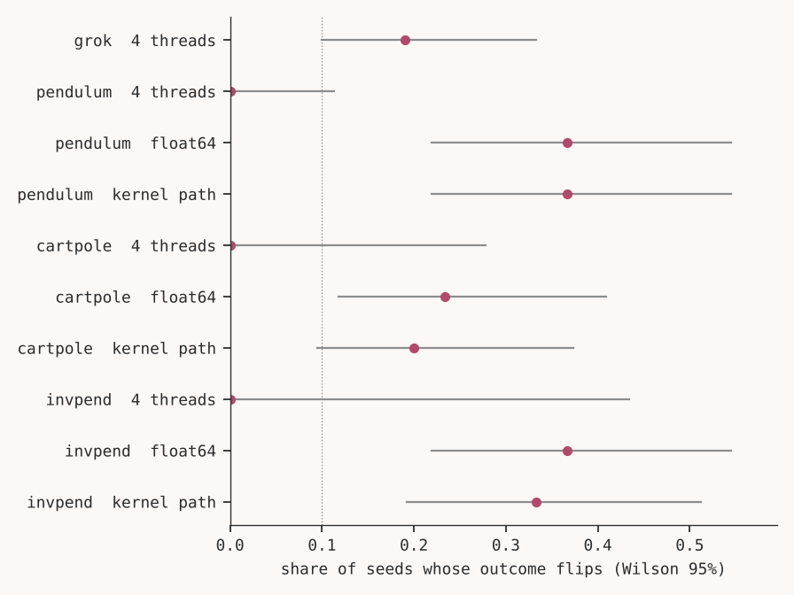

# Does a numerical knife edge appear in small robot policy training?

Huda Mueen. Short write up of the Thabat study. All numbers are rendered from `results/summary.json` by `scripts/render_results.py`. Status: a student study with one machine and a missing GPU arm, not a peer reviewed paper.

## Abstract

Ootani (arXiv 2607.05104) found that, in a 12,000 parameter transformer, changing the CPU thread count or the device flips a minority of same seed grokking outcomes without a detectable change of the average rate, and named the persistence of this effect elsewhere as open. We ask the same paired question for small robot policy training: for a fixed seed, do benign numerical changes flip whether a policy reaches a success threshold? On Pendulum, CartPole and InvertedPendulum with 30 paired seeds per task, switching to float64 or to another MKL kernel path flipped between 0.20 and 0.37 of the outcomes. The average success rate did not change detectably for Pendulum and CartPole, but moved by 0.17 or more for InvertedPendulum, which breaks our preregistered limit. Changing the thread count did not change the final parameters of any small MLP policy, so that perturbation is absent in this setting. There was no clear concentration of flips near the threshold. The CPU versus GPU comparison was not run. The result does not concern large models.

## 1. Introduction

Fixing a seed fixes the random numbers but not the arithmetic. Floating point addition is not associative, so a different reduction order, number type or device gives slightly different values. Seed sensitivity of RL is well documented (Henderson et al. 2018), and GPU nondeterminism alone is known to make deep Q learning runs diverge (Nagarajan et al. 2018). What was missing in the work we found is a paired by seed test of a binary success outcome under named numerical environments, with a test of whether the average rate stays put. The hypotheses, effect sizes and falsifiers were written before any experiment (PREDICTIONS.md).

## 2. Related work

Ootani (2026) reported 49 flipped seeds out of 300 under a thread count change in a grokking transformer, with similar aggregate rates. Nagarajan, Warnell and Stone (2018) left only GPU nondeterminism on in Atari DQN and saw score variance grow, with five runs per group and no paired analysis. Summers and Dinneen (2021), as cited by Ootani, found that sources of nondeterminism give similar variance in supervised training. Altintas et al. (2025) showed that perturbing one weight early in training makes runs diverge. Agarwal et al. (2021) argue for interval estimates over few runs. Our contribution is the paired outcome analysis for RL under controlled numerical changes, with honest scoring of every prediction. We read some of these papers only through abstract pages and summaries (PRIOR_ART.md).

## 3. Method

For each task and seed, the same training run is repeated in a reference environment (CPU, 1 thread, float32) and in arms that change one thing: 4 threads, float64, or the MKL kernel path (MKL_CBWR set to COMPATIBLE). Every random draw comes from a numpy stream derived from the seed, so only network arithmetic differs. Tasks: TD3 on Pendulum and on InvertedPendulum, DQN on CartPole, each with a fixed success threshold, and a grokking transformer on modular addition as a positive control. The training budget was chosen on separate pilot seeds so that the reference success rate is intermediate. Analysis per task and arm: flip rate with Wilson intervals, exact McNemar test with Holm adjustment, and the AUC of the distance to the threshold for flipped against unflipped seeds. A bitwise determinism control and a perturbation check guard the instrument. Details are in METHOD.md. Five dated amendments, three of them after the pilots (and a sixth written after the runs, to record deviations), changed or clarified the plan; all but the sixth precede the evaluation runs, and they are in PREDICTIONS.md.

## 4. Results

The reference environment repeated bitwise on every control seed. Flip rates and paired tests:

| Task | Arm | n | Reference rate | Arm rate | Lost | Gained | Flip rate (95% CI) | McNemar p | Holm p | Bits differ |
|---|---|---|---|---|---|---|---|---|---|---|
| cartpole | float64 | 30 | 0.233 | 0.267 | 3 | 4 | 0.233 [0.118, 0.409] | 1.000 | 1.000 | 1.000 |
| cartpole | kernel path | 30 | 0.233 | 0.167 | 4 | 2 | 0.200 [0.095, 0.373] | 0.688 | 1.000 | 1.000 |
| cartpole | 4 threads | 10 | 0.100 | 0.100 | 0 | 0 | 0.000 [0.000, 0.278] | 1.000 | 1.000 | 0.000 |
| grok | 4 threads | 42 | 0.310 | 0.214 | 6 | 2 | 0.190 [0.100, 0.333] | 0.289 | n/a | 1.000 |
| invpend | float64 | 30 | 0.367 | 0.533 | 3 | 8 | 0.367 [0.219, 0.545] | 0.227 | 1.000 | 1.000 |
| invpend | kernel path | 30 | 0.367 | 0.567 | 2 | 8 | 0.333 [0.192, 0.512] | 0.109 | 0.984 | 1.000 |
| invpend | 4 threads | 5 | 0.400 | 0.400 | 0 | 0 | 0.000 [0.000, 0.434] | 1.000 | 1.000 | 0.000 |
| pendulum | float64 | 30 | 0.467 | 0.433 | 6 | 5 | 0.367 [0.219, 0.545] | 1.000 | 1.000 | 1.000 |
| pendulum | kernel path | 30 | 0.467 | 0.433 | 6 | 5 | 0.367 [0.219, 0.545] | 1.000 | 1.000 | 1.000 |
| pendulum | 4 threads | 30 | 0.467 | 0.467 | 0 | 0 | 0.000 [0.000, 0.114] | 1.000 | 1.000 | 0.000 |

Figure 1. Flip rate per task and arm with Wilson 95 percent intervals.

H1 held for the float64 and kernel path arms of all three tasks. H2 held for Pendulum and CartPole and failed for InvertedPendulum, where the rate moved from 0.37 to 0.53 (float64) and 0.57 (kernel path), although the adjusted McNemar tests were not significant. H3 failed: the AUC of the distance to the threshold was 0.59 pooled, and 0.45 for InvertedPendulum, below the 0.70 that we required. Flipped seeds often moved between a failed and a solved policy, far from the threshold (Figure 3 of RESULTS.md). The positive control flipped 0.19 of 42 seeds under a thread change with rates 0.31 against 0.21. The scored list of 36 predictions has 18 hits, 6 misses, 6 not testable and 6 not run (RESULTS.md).

## 5. Discussion

For small RL policies a benign change of arithmetic is enough to flip the outcome of roughly a fifth to a third of seeds in an intermediate regime, while the average rate mostly stays similar. This is the pattern Ootani described for grokking, extended to a different setting, and it supports reporting RL success as a rate over many seeds under a pinned numerical environment. Our results do not clearly support the idea that flips are near misses (the AUC is weakly above 0.5 for two tasks). They fit a picture in which the rounding difference grows through training and the run ends in a different basin, but we did not test that mechanism. The thread count result is a practical point: for small MLPs, matrix products gave identical bits for 1 and 4 threads, so a thread count check on such models would find nothing.

## 6. Limitations

Thirty seeds give wide intervals, so a hit on H2 means that no change was detected. The success band was chosen so that flips are visible. All CPU runs used one machine. The GPU arm is missing. Some design settings were amended after the pilots. The outcome is a final step snapshot of oscillating training. The full list is in LIMITATIONS.md.

## 7. Reproducibility

Code, configurations, raw rows, tables and figures are in the repository. `pip install -e ".[study,dev]"`, then see METHOD.md. thabat-kit, the reusable harness, is described in ADOPTING.md.

## References

* Agarwal, R., Schwarzer, M., Castro, P. S., Courville, A., Bellemare, M. G. Deep reinforcement learning at the edge of the statistical precipice. NeurIPS 2021.
* Altintas, G. S., Kwok, D., Raffel, C., Rolnick, D. The butterfly effect: neural network training trajectories are highly sensitive to initial conditions. ICML 2025.
* Henderson, P., et al. Deep reinforcement learning that matters. AAAI 2018.
* Nagarajan, P., Warnell, G., Stone, P. Deterministic implementations for reproducibility in deep reinforcement learning. 2018.
* Ootani, Y. Grokking is conditional and fragile: a fully tractable, multi seed study at 12K parameters. arXiv 2607.05104, 2026.
* Summers, C., Dinneen, M. J. Nondeterminism and instability in neural network optimization. ICML 2021 (as cited by Ootani, not read in full).
