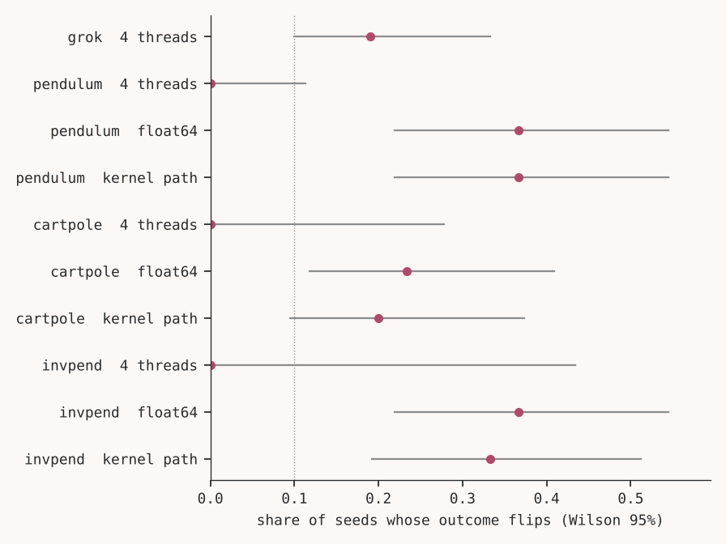
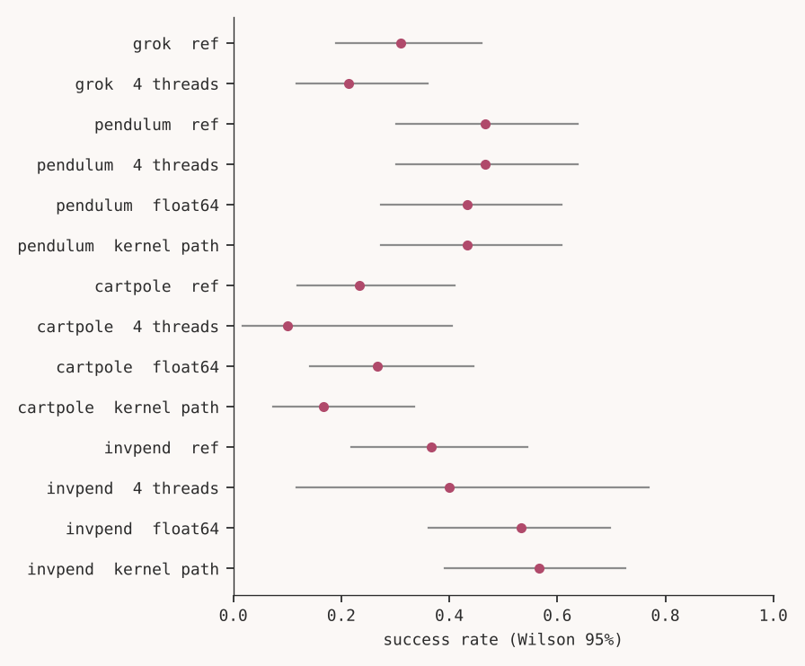
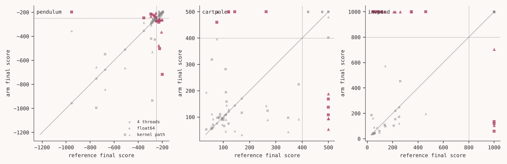
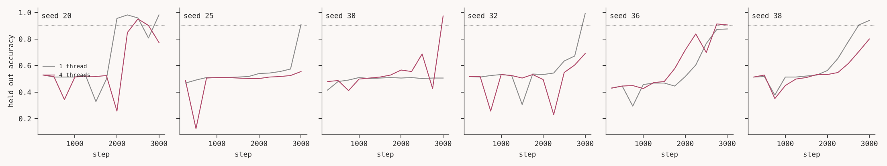

# Results

Author: Huda Mueen. This file is rendered by `scripts/render_results.py` from `results/summary.json` and the tables written by `scripts/analyze.py`. Every number below comes from those files. The predictions are in PREDICTIONS.md, written before any experiment, and amended only in the dated amendment log there.

## Scope of what was run

* Tasks: Pendulum (TD3), CartPole (DQN), InvertedPendulum (TD3, MuJoCo), and the grokking control (small transformer).
* Seeds per environment: {{n_seeds.pendulum}} reference seeds for Pendulum, {{n_seeds.cartpole}} for CartPole, {{n_seeds.invpend}} for InvertedPendulum and {{n_seeds.grok}} for the grokking control. The paired comparisons use the seeds present in both environments: float64 and kernel path arms {{n.pendulum.fp64}} (Pendulum), {{n.cartpole.fp64}} (CartPole) and {{n.invpend.fp64}} (InvertedPendulum). The 4 thread arm was run on {{n.pendulum.thr}} seeds (Pendulum), {{n.cartpole.thr}} (CartPole) and {{n.invpend.thr}} (InvertedPendulum), where it was stopped early to save compute after its runs proved bit identical to the reference. Amendment 1 aimed at 60 seeds per RL task, and compute allowed 30. The minimum of 30 seeds per environment is met except for those capped thread arms.
* The GPU arm was not run. It needs notebooks/gpu_arm.ipynb on a free GPU, and its result files are not in the repository. Its predictions are NOT RUN.
* The determinism control used {{n_determinism.pendulum}} seeds per task.

Pinned environments of the arms that ran:

{{block.envs}}

## Instrument checks

* Determinism: repeating the reference environment gave identical final parameters for every repeated seed, with rates {{determinism_rate.pendulum:.2f}} (Pendulum), {{determinism_rate.cartpole:.2f}} (CartPole), {{determinism_rate.invpend:.2f}} (InvertedPendulum) and {{determinism_rate.grok:.2f}} (grokking control). Flip counts are therefore not caused by run to run noise in the reference.
* Perturbation: in the float64 and kernel path arms the final parameters differ from the reference in every seed (rates {{perturbation_rate.pendulum.fp64:.2f}} and {{perturbation_rate.pendulum.isa:.2f}} for Pendulum, and equally 1.00 in the other tasks, see the table). In the 4 thread arm of the three RL tasks the final parameters were bit identical to the reference in every seed (rates {{perturbation_rate.pendulum.thr:.2f}}, {{perturbation_rate.cartpole.thr:.2f}} and {{perturbation_rate.invpend.thr:.2f}}). Thread count is therefore no perturbation for these small MLPs, and the thread predictions are NOT TESTABLE, as Amendment 1 anticipated. For the small transformer, 4 threads changed the parameters in rate {{perturbation_rate.grok.thr:.2f}} of the seeds.

## Paired comparison by seed

Lost is a seed that succeeded in the reference and failed in the arm, gained is the reverse. Intervals are Wilson 95 percent. Holm adjusted p values cover all RL comparisons. Bits differ is the share of seeds with different final parameters. The grokking control uses the unadjusted p value.

{{block.summary}}

Figure 1. Flip rate per task and arm with Wilson 95 percent intervals. The dotted line is the 0.10 level used in the H1 predictions.

Figure 2. Success rate in the reference and in each arm, with Wilson 95 percent intervals.

Figure 3. Final score of the reference run against the final score of the arm for the same seed. Dotted lines mark the success threshold. Rose points are seeds whose outcome flipped. Points far from the diagonal are runs that ended in a different place, not runs that missed the threshold by a small amount.

Figure 4. Held out accuracy during training for seeds of the grokking control whose outcome flipped between 1 and 4 threads.

## Where flips occur (H3)

The AUC compares the distance to the threshold of flipped and unflipped seed and arm pairs, pooled over arms with a valid perturbation check. A value of 0.5 means no relation and 1.0 means flipped seeds are always the closest to the threshold.

{{block.h3}}

## All predictions scored

HIT: {{count.hit}}. MISS: {{count.miss}}. NOT TESTABLE: {{count.not_testable}}. NOT RUN: {{count.not_run}}. Total: {{count.total}}. The scoring is done by `thabat_kit.scorer` on `results/summary.json`, not by hand.

{{block.predictions}}

## Reading the results

H1 (flips occur). The float64 and kernel path arms flipped between {{flip_rate.cartpole.isa:.2f}} and {{flip_rate.pendulum.fp64:.2f}} of the seeds for Pendulum and CartPole and about a third for InvertedPendulum (see table), all above the 0.10 level, and all HIT. This is a result about magnitude. That RL runs diverge under tiny numerical differences was already known, and we do not claim it as new.

H2 (average rate unchanged). It holds for Pendulum and CartPole in both arms, with absolute differences of rate between {{abs_delta.pendulum.fp64:.2f}} and {{abs_delta.cartpole.isa:.2f}}. It is a MISS for InvertedPendulum in both arms: the absolute difference of rates was {{abs_delta.invpend.fp64:.2f}} (float64) and {{abs_delta.invpend.isa:.2f}} (kernel path), above the 0.10 limit, although the Holm adjusted McNemar p values ({{mcnemar_holm_p.invpend.fp64:.2f}} and {{mcnemar_holm_p.invpend.isa:.2f}}) did not reach 0.05. In both arms the success rate moved up (from {{ref_rate.invpend:.2f}} to {{arm_rate.invpend.fp64:.2f}} and {{arm_rate.invpend.isa:.2f}}), with more seeds gained than lost. With 30 seeds this is compatible with a true change and with none. We keep it as a miss, because the prediction was written with the 0.10 limit, and we do not explain it away. A sound reading is that an unchanged average cannot be assumed, and that a larger sample is needed for this task.

H3 (flips near the threshold). All four H3 predictions are MISS. For Pendulum and CartPole and the pooled set the AUC lies between 0.55 and 0.70, which the predictions define as inconclusive and score as a miss. For InvertedPendulum it is below 0.55, so there is no support. Figure 3 shows why: in CartPole and InvertedPendulum many flipped seeds jump between a failed policy and a solved one, far from the threshold, and the scores of these tasks are close to bimodal. This agrees better with the competing account named in PREDICTIONS.md, that a rounding difference early in training can send a run to a different basin whatever its reference score was, than with the account that flips are near misses. Pendulum scores bunch just below and above the threshold, so some flips there are near misses.

Positive control. The grokking control with 4 threads against 1 thread flipped {{flip_rate.grok.thr:.2f}} of {{n.grok.thr}} seeds, which is a HIT of PC1 (at least 0.08), and the aggregate rate moved from {{ref_rate.grok:.2f}} to {{arm_rate.grok.thr:.2f}} with an unadjusted McNemar p of {{mcnemar_p.grok.thr:.2f}}, a HIT of PC2. The absolute difference ({{abs_delta.grok.thr:.3f}}) is close to the 0.10 limit, so this hit is narrow. The control reproduces the pattern reported by Ootani in kind, on a different task, with a smaller model setup and a different threshold, and with a flip rate in the same range.

Coincidence to note. In Pendulum the float64 arm and the kernel path arm have the same counts of lost and gained seeds. The two arms differ in the final parameters of every seed and in the outcomes of several seeds, so they are different runs, and the equal counts are a coincidence.

What these results do not show is in LIMITATIONS.md. An exploratory table of flip rates at moved thresholds (not part of the predictions) is in `tables/threshold_sweep_exploratory.csv`.
